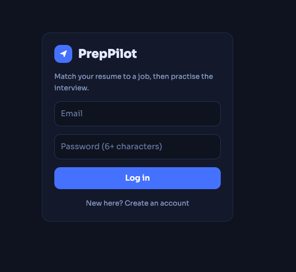
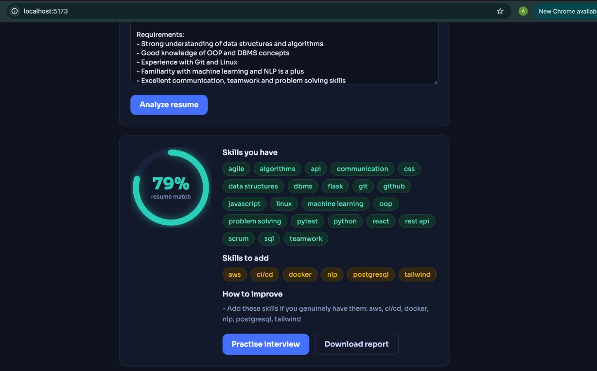
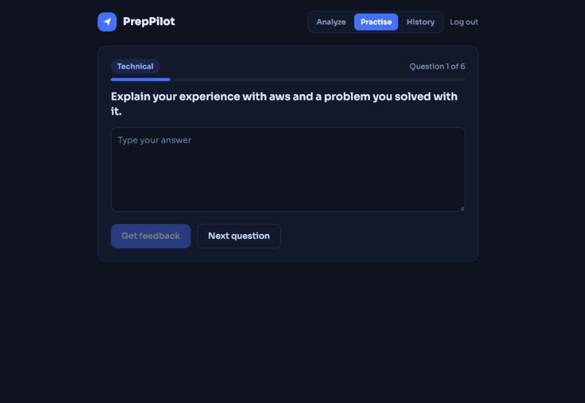
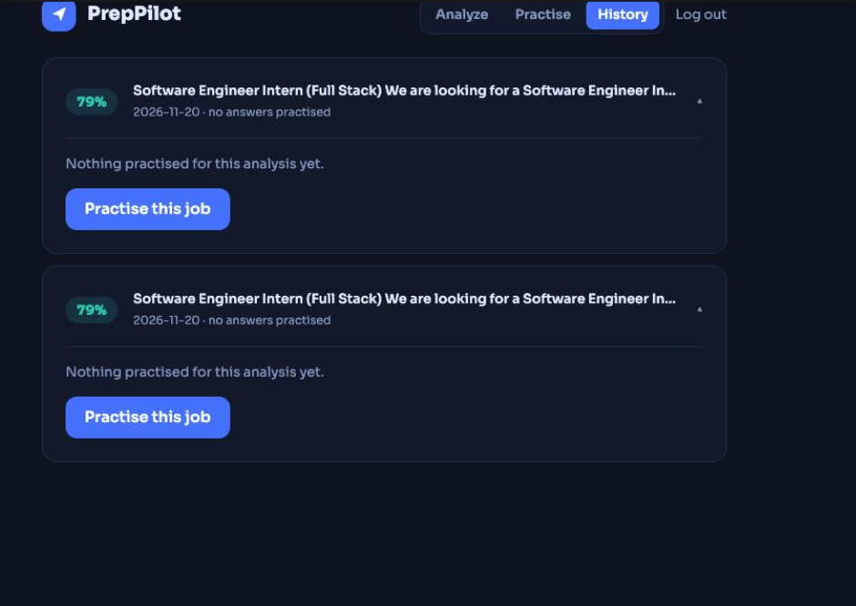

# PrepPilot: AI-Powered Resume Analyzer and Interview Preparation Tool


PrepPilot helps students and job seekers prepare for placements. Upload a resume and paste a job description. The app calculates a match score, lists missing skills, generates role-specific interview questions, and gives feedback on your typed answers using an LLM. Practice sessions are saved so you can track your progress.

Built for **Fundamentals of Agile Software Development (26B16CS314)**, B.Tech V Semester, Jaypee Institute of Information Technology, Noida.

## Team

| Name           | Roll No.   | Scrum Role         |
| -------------- | ---------- | ------------------ |
| Aadya Mudgal   | 2401030368 | Product Owner      |
| Mokshi Mittal  | 2401030326 | Scrum Master       |
| Jahnavi Singh  | 2401030367 | Developer          |
| Shikhar Shukla | 2401030364 | Developer          |
| Aanvi Sawhney  | 2401030351 | QA / Documentation |

**Submitted to:** Dr. Indu Chawla, Mr. Akshitraj Patel

## Features

- Register and log in
- Upload a resume as a PDF and extract its text
- Paste a job description and get a match score with a skill-gap report
- Role-specific technical and HR interview questions
- LLM feedback on typed answers
- Practice history to track progress

## Tech Stack

| Layer              | Technology                   |
| ------------------ | ---------------------------- |
| Frontend           | React.js, Vite, Tailwind CSS |
| Backend            | Python, Flask (REST APIs)    |
| AI / NLP           | Gemini API, PyPDF            |
| Database           | SQLite                       |
| Testing and CI     | PyTest, GitHub Actions       |
| Project Management | Trello (Scrum board), GitHub |

## Project Structure

```
preppilot/
├── .github/workflows/ci.yml   # CI pipeline
├── backend/
│   ├── app.py                 # Flask app and API routes
│   ├── matcher.py             # Resume-to-JD matching
│   ├── llm.py                 # LLM integration
│   ├── tests/                 # PyTest tests
│   └── requirements.txt
├── frontend/                  # React app (Vite)
│   └── src/
└── docs/                      # Screenshots and Scrum artifacts
```

## Getting Started

### Prerequisites

- Python 3.10+
- Node.js 18+
- A Gemini API key

### 1. Backend

```bash
cd backend
pip install -r requirements.txt
cp .env.example .env
```

Open `.env` and add your key: `GEMINI_API_KEY=your_key_here`

Then start the server (runs on **http://localhost:5001**):

```bash
python app.py
```

### 2. Frontend

In a second terminal:

```bash
cd frontend
npm install
npm run dev
```

⚠️ Open the URL printed in the terminal (usually http://localhost:5173).

## Running Tests

```bash
cd backend
python -m pytest -q
```

Tests also run automatically on every push through GitHub Actions.

## Screenshots

| Login                                | Analysis                                   |
| ------------------------------------ | ------------------------------------------ |
|  |  |

| Practice                                   | History                                  |
| ------------------------------------------ | ---------------------------------------- |
|  |  |

## Agile Process

We followed Scrum in three 2-week sprints (foundation, core features, completion), with sprint planning, daily stand-ups, reviews and retrospectives. We also used XP practices such as pair programming (driver/navigator) and test-driven development. Sprint artifacts are in the `docs/` folder.

## Limitations

- Skill matching uses a keyword list rather than full semantic analysis
- Depends on an external LLM API and an internet connection
- Only typed answers are supported
